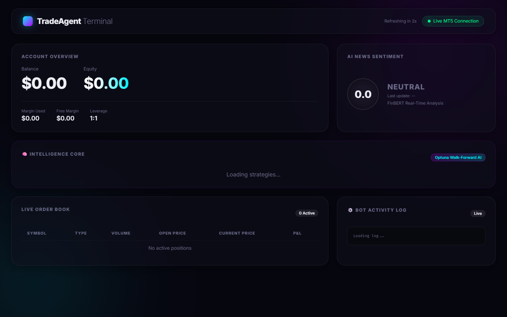

# 🤖 TradeAgent — Autonomous Multi-Market Algorithmic Trading Framework

[](https://python.org)
[](https://fastapi.tiangolo.com)
[](https://pytorch.org)
[](https://xgboost.readthedocs.io)
[](https://www.metatrader5.com)
[](LICENSE)

An institutional-grade, fully autonomous algorithmic trading and research framework designed for **Crypto, Forex, and Indices**. TradeAgent integrates classical technical analysis, machine learning predictors (Transformers, XGBoost, DRL), macroeconomic calendar guards, sentiment NLP, and an interactive real-time telemetry dashboard.

---

## 📸 System Showcase

### Live Telemetry & Monitoring Dashboard
*Real-time account balance tracking, FinBERT news sentiment gauge, Optuna walk-forward status, and live order book.*



---

## 🏛️ System Architecture

TradeAgent is designed around an event-driven, decoupled multi-agent loop:

```
┌────────────────────────────────────────────────────────┐
│                   Data Stream Layer                    │
│   MT5 Tick Feed  •  CCXT WebSockets  •  FRED Macro     │
└───────────────────────────┬────────────────────────────┘
                            │
┌───────────────────────────▼────────────────────────────┐
│                Feature & Alpha Generation              │
│  • Smart Money Concepts (FVG, Order Blocks, Liquidity) │
│  • Deep Learning: Temporal Transformer Predictor       │
│  • Gradient Boosting: Multi-Asset XGBoost Classifiers  │
│  • Reinforcement Learning: DRL Position Sizing         │
│  • NLP: FinBERT Real-Time News Sentiment Engine        │
└───────────────────────────┬────────────────────────────┘
                            │
┌───────────────────────────▼────────────────────────────┐
│              Multi-Agent Decision Core                 │
│  Trend Agent  •  Breakout Agent  •  Mean Reversion     │
│  Autonomous Strategy Optimizer  •  LLM Validator       │
└───────────────────────────┬────────────────────────────┘
                            │
┌───────────────────────────▼────────────────────────────┐
│              Risk Management & Execution               │
│  Dynamic ATR Trailing Stops  •  Correlation Guards     │
│  Broker Routing: MT5  /  CCXT  /  OANDA  /  Paper      │
└────────────────────────────────────────────────────────┘
```

---

## ✨ Key Capabilities

### 1. Multi-Model Machine Learning Engine
* **Temporal Transformer:** Sequences multi-timeframe candle embeddings to predict next-bar return probabilities.
* **XGBoost Ensembles:** Pre-trained and optimized models for high-liquidity pairs (`BTC/USDT`, `ETH/USDT`, `XAU/USD` (Gold), `US30`, `EUR/USD`).
* **Deep Reinforcement Learning (DRL):** Custom gym environment optimizing reward functions based on Sortino and Calmar ratios.

### 2. Institutional Trading Strategies
* **Smart Money Concepts (SMC):** Automated detection of Liquidity Sweeps, Fair Value Gaps (FVG), Market Structure Shifts (MSS), and mitigation zones.
* **Asian Judas Swing & Session Timing:** London/NY Open volatility breakout algorithms.
* **LLM Conviction Validation:** Contextual trade validation assessing market narrative before triggering high-leverage orders.

### 3. Comprehensive Risk Architecture
* Automatic stop-loss & take-profit calculation based on market volatility (ATR).
* Hard daily drawdown circuit breakers and max exposure limits per currency basket.
* Macro event awareness: Automatic trading pause during high-impact CPI, NFP, and FOMC announcements.

### 4. Real-Time Telemetry & Web Dashboard
* Built with **FastAPI** serving a modern glassmorphic interface.
* WebSocket live updates for open positions, trade histories, and sentiment scores.
* Telegram bot integration for instant execution alerts and remote emergency commands (`/pause`, `/kill`, `/status`).

---

## 🛠️ Quickstart

### 1. Installation

```bash
# Clone the repository
git clone https://github.com/AryaMehr-Nam/Autonomous-Trading-Framework.git
cd Autonomous-Trading-Framework

# Set up virtual environment
python -m venv venv
venv\Scripts\activate   # Linux/macOS: source venv/bin/activate

# Install dependencies
pip install -r requirements.txt
```

### 2. Configuration

Copy the example environment file and add your broker/model credentials:

```bash
cp .env.example .env
```

Configure parameters in `config/trading_params.yaml`.

### 3. Run the Dashboard

```bash
uvicorn dashboard.app:app --host 127.0.0.1 --port 8000 --reload
```
Navigate to `http://127.0.0.1:8000/static/index.html` in your browser.

### 4. Run Backtesting

```bash
python run_backtest.py
```

---

## 📄 License

Distributed under the MIT License. See `LICENSE` for more information.
